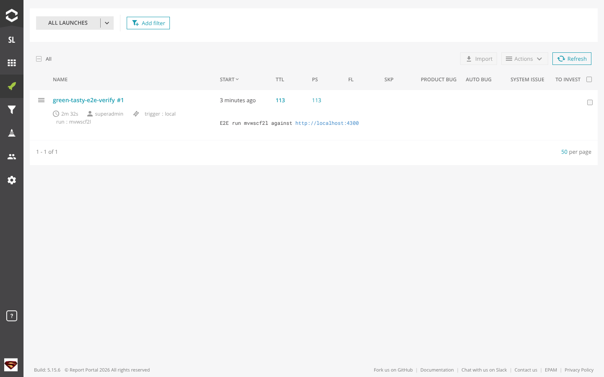
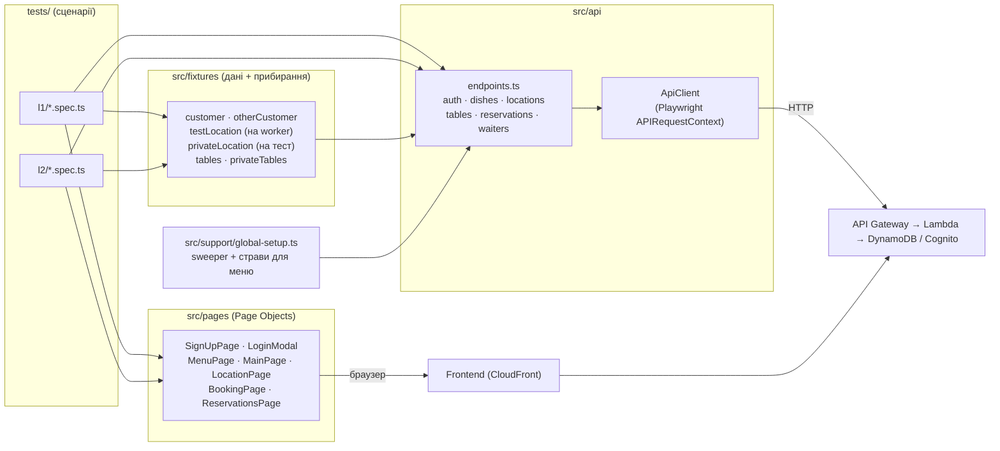

# E2E-тести Green & Tasty — ДЗ #8 (Test Automation)

**Напрями:** **Напрям 1** — груповий pre-order, рівні **1–3** (власна реалізація ДЗ #5 + ДЗ #6, інтегрована й розгорнута) і **Напрям 2** — наявний функціонал, рівні **1** (реєстрація, вхід, меню) і **2** (бронювання столу).
Напрям 2 зроблено 31.10, коли фронтенд ДЗ #6 ще не був підключений до розгорнутого застосунку. Після інтеграції 02.11 ([PR #5](https://github.com/granchenkooleg/marathon2026/pull/5)) додано Напрям 1 — [розділ нижче](#напрям-1-груповий-pre-order).

**Підхід:** Playwright Test (TypeScript), **Page Object Model + API-клієнт + fixtures**, без BDD.
**⭐:** звіти в Report Portal (перевірено локально) і пайплайн в AWS CodeBuild через Terraform ([розділ нижче](#-report-portal-і-пайплайн-в-aws)).
Чому так:
- одна мова з фронтендом застосунку (TypeScript);
- trace, відео, скриншоти, HTML-звіт, теги, паралельність і retries уже вбудовані, без додаткових бібліотек;
- fixtures дають кожному тесту власні дані й автоматичне прибирання;
- Gherkin не дав би тут нової цінності: тести читаються як сценарії й без нього.

Результат на живому середовищі: **137 тестів (Напрям 1 — 24, Напрям 2 — 113), усі passed**; серед них 1 очікуване падіння тесту відкритого дефекту D2 (`test.fail()`). 4 workers, ~3–4 хв. Останній запуск — GitHub Actions проти розгорнутого стенда 03.11.2026, після деплою виправлень ([запуск](https://github.com/granchenkooleg/marathon2026/actions/runs/41598297925): 137 passed за 3.4 хв, без повторів). До деплою той самий набір давав 127 passed + 10 failed — рівно тести виправлених дефектів. Попередній результат Напряму 2 (01.11.2026, до виправлень): 113 тестів = 102 passed + 11 known defects ([запуск](https://github.com/granchenkooleg/marathon2026/actions/runs/41234349867)). Детально про дефекти — [нижче](#знайдені-дефекти). Окремі запуски іноді ловлять HTTP 504 від API Gateway під навантаженням (див. [обмеження](#обмеження-й-ризики)).

---

## Що покрито

| Вимога ДЗ | Як перевіряється | Файл |
|---|---|---|
| **L1.** Реєстрація клієнта і вхід під ним | UI: форма → sign-in → роль `Customer` у UI та в `GET /me` | `tests/l1/registration.spec.ts` |
| Ім'я / прізвище: 1, 2, 50, 51 символ; латиниця, дефіс, апостроф | UI, кожне правило окремо; плюс серверні перевірки через API | `registration.spec.ts` |
| Email: формат; 128 / 254 / 255 символів | UI + API | `registration.spec.ts` |
| Пароль: 7, 8, 16, 17 символів; підтвердження збігається | UI (індикатор правил + блокування) + API | `registration.spec.ts` |
| Реєстрація завжди створює клієнта | API: поле `role: Waiter` у запиті ігнорується | `registration.spec.ts` |
| Вхід із правильними й неправильними даними | UI + API (401, порожні поля, незареєстрований email) | `tests/l1/login.spec.ts` |
| Меню: усі страви, фільтр за категоріями, сортування за ціною й популярністю в обидва боки | UI порівнюється з даними, які сторінка отримала, і з API; ціни монотонні | `tests/l1/menu.spec.ts` |
| Пошук за назвою | API (часткове, без урахування регістру, порожній результат); в UI поля пошуку немає → D5 | `menu.spec.ts` |
| Популярні страви, список локацій, відкриття страви й локації | UI + API | `menu.spec.ts` |
| Неіснуюча страва / локація | API 404 з повідомленням; UI-сторінка неіснуючої локації показує помилку | `menu.spec.ts` |
| **L2.** Знайти вільний стіл → забронювати → бачити в «моїх бронюваннях» із правильними часом, столом, гостями; цей час більше не пропонується | UI від пошуку до картки бронювання; стіл перевіряється через API (у картці UI його немає) | `tests/l2/booking.ui.spec.ts` |
| Початок за 14 / 15 / 16 хв | API (UI пропонує лише слоти по 30 хв) | `tests/l2/booking-rules.api.spec.ts` |
| Завершення після початку | API: раніше, рівно, +1 хв | `booking-rules.api.spec.ts` |
| Гості: місткість −1 / рівно / +1 | API + UI (стіл не пропонується; у редагуванні «+» неактивний) | `booking-rules.api.spec.ts`, `booking.ui.spec.ts` |
| Перетин і суміжність інтервалів | API: той самий, частковий, охоплюючий, суміжні до/після, проміжок 14 і 15 хв, інший стіл | `booking-rules.api.spec.ts` |
| Редагування за тими самими правилами; скасування; повторне скасування | UI (зміна часу й гостей, скасування) + API (усі межі) | обидва файли L2 |
| Чужі бронювання | API: не в моєму списку, не редагуються (403), не скасовуються (403), читання за id → D7; UI: не видно в «моїх бронюваннях» | `tests/l2/access.api.spec.ts`, `booking.ui.spec.ts` |
| Неавторизований користувач | UI: пошук працює, бронювання веде на вхід, нічого не створено; «мої бронювання» → вхід. API: 401 на всі операції | `booking.ui.spec.ts`, `access.api.spec.ts` |

Кожен рівень має і позитивні, і негативні сценарії. Теги: `@L1`, `@L2`, `@ui`, `@api`, `@smoke`, `@known-defect`.

| | UI | API | Разом |
|---|---|---|---|
| L1 | 47 | 15 | 62 |
| L2 | 11 | 40 | 51 |

**Чому L2 переважно через API.** Вимоги L2 — це межі (14/15/16 хв, ±1 гість, проміжок 14/15 хв), а UI пропонує лише готові слоти по 30 хв, тож до цих меж через сторінку не дістатися. ДЗ дозволяє готувати й перевіряти дані поза UI. Основні сценарії (знайти → забронювати → побачити → змінити → скасувати, чужі, неавторизований) пройдено через UI.

---

## Напрям 1: груповий pre-order

Тестується власна реалізація: бекенд ДЗ #5 і екран Owner з ДЗ #6, розгорнуті разом. Умова — офіційний `homework-aqa.md`, «Напрям 1». Теги: `@D1` і `@D1-L1` / `@D1-L2` / `@D1-L3`; запуск: `npm run test:d1`.

| Вимога | Як перевіряється | Файл |
|---|---|---|
| **L1.** Owner бачить учасників, страви, кількості й суму по кожному | UI (картки, підсумки, плашка про непідтверджених) + API (суми узгоджені) | `tests/d1/l1-participants.spec.ts` |
| Загальна сума = сума по учасниках і змінюється з кошиком | API: гість додає ще страву → суми перераховані | `l1-participants.spec.ts` |
| Непідтверджений учасник і учасник без страв у списку | UI («Still choosing», «No dishes yet», $0.00) + API | `l1-participants.spec.ts` |
| Група без учасників | API `{ participants: [], total: 0 }` + UI порожній стан, Submit неактивний | `l1-participants.spec.ts` |
| Список бачить лише Owner | API: інший клієнт і офіціант локації → 403, гість і анонім → 401 | `l1-participants.spec.ts` |
| Неіснуюча група | API 404 з повідомленням | `l1-participants.spec.ts` |
| **L2.** Успішне підтвердження: лише підтверджені кошики, однакові страви об'єднані | UI (консолідований список, Grand Total, бейдж «Sent to Restaurant», read-only після перезавантаження) + API (статуси групи й замовлення, склад замовлення, відповідь submit) | `tests/d1/l2-submit.spec.ts` |
| Офіціант бачить підтверджене замовлення | UI офіціанта: «Reservations» → «Pre-order» → страви й кількості | `l2-submit.spec.ts` |
| Неможливо підтвердити: немає підтверджених кошиків / немає замовлення / немає бронювання / немає групи | API, кожна умова окремо, з повідомленням; група лишається `Open` | `l2-submit.spec.ts` |
| Повторне підтвердження | API `400 GroupReservationSubmitted`, страви не додаються вдруге | `l2-submit.spec.ts` |
| Підтвердження не від Owner | API: інший клієнт, офіціант → 403; гість, анонім → 401 | `l2-submit.spec.ts` |
| **L3.** Видалення одного з кількох, суми перераховані | UI (діалог Remove Guest, toast, картки, Grand Total) + API | `tests/d1/l3-remove.spec.ts` |
| Видалення того, хто вже підтвердив; останнього учасника | API: відповідь — оновлений список; `[]` і `0` після останнього | `l3-remove.spec.ts` |
| Учасник іншої групи → 400; неіснуючий → 404 | API, з повідомленнями; обидві групи не змінились | `l3-remove.spec.ts` |
| Видалення не від Owner | API: інший клієнт, офіціант → 403; інший гість, анонім → 401 | `l3-remove.spec.ts` |
| Наскрізний сценарій | UI: «Reservations» → «Group Pre-Order» → видалити одного → Submit → офіціант бачить замовлення без видаленого | `tests/d1/e2e.ui.spec.ts` |

24 тести: 7 UI, 17 API. Дані для кожного тесту — власні: бронювання на власному столі, гості, замовлення; тести офіціанта беруть окрему локацію з власним офіціантом.

**Поведінка, яку ДЗ не визначає (обрано й зафіксовано тестами)**

| Ситуація | Поведінка |
|---|---|
| Не-Owner (інший клієнт, офіціант) | `403 Only the reservation owner can perform this action.` |
| Неавторизований або гість на маршрутах Owner | `401` від Cognito-авторизатора API Gateway |
| Повторний submit | `400`, `errorCode: GroupReservationSubmitted`; склад замовлення не змінюється |
| Submit чужої групи разом із власним бронюванням | `400 Group reservation does not belong to this reservation.` |
| Власні страви Owner | Це його звичайний pre-order (кошик). Submit **додає** до нього страви гостей. Сесія Owner у списку учасників не показується |
| Видалення останнього учасника | `200`, `{ participants: [], total: 0 }` |
| «У підтверджених кошиках немає страв» | Через API недосяжно: гість не може підтвердити порожній кошик (`400 The cart is empty`). Тест перевіряє саме це; гілку бекенду покриває unit-тест |
| Повідомлення «бронювання не знайдено» | `404 Reservation not found.` (бекенд не додає id) |

---

## Запуск

Потрібно: Node.js 20+ (перевірено на 22).

```bash
cd aqa
cp .env.example .env        # заповнити BASE_URL і API_URL своїми адресами
npm ci
npx playwright install chromium
npm test
```

`.env` у `.gitignore`. У репозиторії немає ні адрес, ні паролів: тестові користувачі реєструються на кожен запуск.

### Підмножини

| Що запустити | Команда |
|---|---|
| Напрям 1 (груповий pre-order) | `npm run test:d1` |
| Напрям 2: рівень 1 / рівень 2 | `npm run test:l1` / `npm run test:l2` |
| Лише UI / лише API | `npm run test:ui` / `npm run test:api` |
| Швидкий smoke (4 тести) | `npm run test:smoke` |
| Лише тести відомих дефектів | `npm run test:known-defects` |
| Будь-яка комбінація | `npx playwright test --grep "@L2.*@ui"` |
| Один файл / один тест | `npx playwright test tests/l1/menu.spec.ts -g "price"` |

### Звіт і матеріали для розбору

- HTML-звіт: `aqa/reports/html` → `npm run report`.
- JUnit і JSON: `aqa/reports/junit.xml`, `aqa/reports/results.json`.
- Для впалих тестів — скриншот, відео й trace: `aqa/test-results/<тест>/`. Trace відкривається командою `npx playwright show-trace <шлях>/trace.zip`. Вони зберігаються лише для впалих тестів (`retain-on-failure`).

---

## CI (GitHub Actions)

Workflow: [`.github/workflows/e2e.yml`](../.github/workflows/e2e.yml). Запускається на push у `master` і на pull request, якщо змінено `aqa/**`, а також вручну (**Actions → E2E tests → Run workflow**, поле `grep` для підмножини, напр. `@L1`).

**Одноразове налаштування:** у **Settings → Secrets and variables → Actions → Variables** додати змінні репозиторію `BASE_URL` (CloudFront URL фронтенду) і `API_URL` (URL stage API Gateway). Без них job зупиняється на першому кроці зі зрозумілою помилкою.

Що робить job:
1. перевіряє конфігурацію, ставить залежності й Chromium, робить type check;
2. запускає тести (`retries: 1`, 4 workers). Крок має `continue-on-error`, тож **впалий тест не зупиняє пайплайн**;
3. публікує таблицю результатів у **Summary** запуску;
4. вивантажує артефакти `playwright-html-report` і `failure-evidence` (trace, відео, скриншоти), зберігаються 14 днів;
5. наприкінці позначає job червоним, якщо були неочікувані падіння.

---

## ⭐ Report Portal і пайплайн в AWS

### Report Portal

Репортер `@reportportal/agent-js-playwright` вмикається, лише коли задано всі три змінні: `RP_ENDPOINT`, `RP_PROJECT`, `RP_API_KEY`. Без них запуск працює як завжди. Теги тестів (`@L1`, `@ui`, `@known-defect` …) потрапляють у Report Portal як атрибути `tag:…`. Запуск має атрибути `trigger` (local / github-actions / aws-codebuild) і `run` (id запуску). До впалого тесту прикріплюються скриншот, відео, trace і error context. Перевірено окремим навмисно впалим тестом; known-defect тести вважаються пройденими, тому отримують лише error context.

Локально (Docker, ~6 ГБ RAM):

```bash
curl -LO https://raw.githubusercontent.com/reportportal/reportportal/master/docker-compose.yml
docker compose -p reportportal up -d
```

1. Відкрити http://localhost:8080 і увійти як `superadmin` / `erebus` (стандартні дані локального Report Portal).
2. **Profile → API Keys → Generate**.
3. Додати ключ у `aqa/.env`:

```bash
RP_ENDPOINT=http://localhost:8080/api/v1
RP_PROJECT=superadmin_personal
RP_API_KEY=<згенерований ключ>
```

4. `npm test` — після запуску в консолі з'явиться посилання на launch.

Перевірено 31.10.2026 на Report Portal 5.15: launch `green-tasty-e2e-verify`, 113 / 113 passed, з атрибутами запуску й тегами тестів:



У GitHub Actions той самий репортер вмикається змінними `RP_ENDPOINT`, `RP_PROJECT` і секретом `RP_API_KEY`. Report Portal має бути доступний з інтернету: локальний Docker-інстанс із GitHub не видно.

### Пайплайн в AWS CodeBuild

Terraform: [`infra/terraform/codebuild_e2e.tf`](../infra/terraform/codebuild_e2e.tf). Кроки збірки: [`aqa/buildspec.yml`](buildspec.yml). Ресурси **opt-in** (`e2e_enabled = false` за замовчуванням), тому звичайний `terraform apply` інфраструктури нічого не змінює.

| Ресурс | Навіщо |
|---|---|
| `aws_codebuild_project.e2e` (`restaurant-e2e`) | Клонує публічний репозиторій без GitHub-креденшалів (`NO_SOURCE` + `git clone`), ставить Chromium, запускає тести (`BUILD_GENERAL1_MEDIUM`, 4 workers) |
| CodeBuild report group `restaurant-e2e-junit` | Результати тестів у консолі CodeBuild (JUnit), історія запусків |
| S3 `restaurant-e2e-reports-<account>` | HTML-звіт, trace, відео, скриншоти: `runs/<build-id>/e2e/`, зберігаються 14 днів |
| CloudWatch log group | Логи збірки, 14 днів |
| IAM role | Лише логи, свій бакет, свої report groups і (за потреби) один SSM-параметр |
| `aws_scheduler_schedule.e2e` (опційно) | Регулярний регрес за `e2e_schedule_expression`, як `weekly_reports` |

```bash
cd infra/terraform
terraform apply -var e2e_enabled=true \
  -var 'e2e_api_url=https://<api-id>.execute-api.us-west-2.amazonaws.com/develop'
aws codebuild start-build --project-name restaurant-e2e
```

`BASE_URL` за замовчуванням — CloudFront-дистрибуція з цього ж стеку. Report Portal для CodeBuild: ключ кладеться в SSM (`aws ssm put-parameter --type SecureString --name /restaurant/e2e/rp-api-key --value <key>`), а в Terraform задаються `e2e_report_portal_endpoint`, `e2e_report_portal_project`, `e2e_report_portal_api_key_parameter`.

Як і в GitHub Actions, впалий тест не зупиняє публікацію: фаза `build` стає FAILED, але CodeBuild однаково вивантажує report group і артефакти.

**Що перевірено, а що ні:** `terraform validate` і `terraform fmt` проходять (AWS provider 5.100). Кроки buildspec ті самі, що в GitHub Actions. **Сам `terraform apply` і запуск у CodeBuild я не виконував:** для цього потрібен доступ до AWS-акаунту.

---

## Архітектура



| Шар | Відповідальність |
|---|---|
| `tests/` | Сценарії й перевірки. Нічого не знають про CSS чи URL. |
| `src/pages/` | Локатори й дії сторінок. Пріоритет локаторів: role + accessible name → label/placeholder → CSS (лише там, де застосунок не дає ролей: картки страв, модалка редагування). |
| `src/api/` | Тонкий клієнт над `APIRequestContext`, тож кожен API-виклик видно в trace. |
| `src/fixtures/` | Тестові дані з гарантованим прибиранням. |
| `src/data/` | Генератори унікальних даних і дат (`now + N`, UTC). |
| `src/support/` | Global setup, дефекти, допоміжні кроки (вхід через `localStorage`, прибирання бронювань). |

---

## Тестові дані, незалежність, час

- **Унікальність.** Кожен запуск має `runId` (base36-мітка часу). Його містить кожен email (`aqa-e2e.<runId><random>@example.com`), адреса кожної локації (`AQA-E2E <runId> …`) і назва кожної страви.
- **Незалежність.** Кожен тест отримує нового клієнта. Кожен L2-тест бронює **власний новий стіл**; UI-тести пошуку мають ще й **власну локацію**, щоб у результатах був лише їхній стіл. Тести можна запускати в будь-якому порядку й паралельно.
- **Прибирання** (перевірено: після запусків у середовищі лишаються тільки початкові `123 Test St` і `Caesar Salad`):
  - активні бронювання клієнта скасовуються після тесту. Якщо до початку менше 30 хв, бронювання спершу переноситься на кілька днів уперед, бо скасувати пізніше бекенд не дозволяє;
  - локації видаляються разом зі столами й офіціантом (`DELETE /locations/{id}?force=true`);
  - 6 страв для перевірки меню (по 2 на категорію, різні ціни) створює global setup і видаляє global teardown;
  - **sweeper** на початку кожного запуску видаляє залишки `AQA-E2E`-даних старших за 3 год (від перерваних запусків).
- **Що прибрати неможливо:** користувачів Cognito і записи скасованих бронювань (API для видалення немає). Тому email і дані унікальні на кожен запуск.
- **Час:** усе в UTC (бекенд закінчує робочий день о 22:00 UTC). Браузер запускається з `timezoneId: 'UTC'`, дати генеруються як `now + N` / «через N днів о HH:MM UTC». «Рівно 15 хв» надсилається як 15 хв + 20 с: сервер рахує від моменту отримання запиту.
- **Офіціант** у цьому застосунку не реєструється сам, а без нього бекенд не приймає бронювання. Тому кожна тестова локація отримує власного офіціанта: реєстрація + `POST /waiters`.

---

## Рішення для випадків, які ДЗ не визначає

| Ситуація | Що робить застосунок | Як тестується |
|---|---|---|
| Повторне скасування | `200`, статус лишається `Cancelled` (ідемпотентно) | Перевіряється, що стан не змінився |
| Суміжні інтервали одного столу | Відхиляються: застосунок тримає 15 хв між бронюваннями (буфер на прибирання). Це суворіше за «не перетинаються» | Перевіряються обидві межі буфера: 14 хв → відмова, 15 хв → ок |
| Скасування менш ніж за 30 хв | `400 Too late to cancel` | Межі 29 / 31 хв |
| Редагування з перетином | `409` (при створенні — `400`) | Перевіряються коди, які повертає API |
| Обмеження місткості в UI | Пошук не показує замалі столи; у редагуванні «+» неактивний на межі | UI-тести |
| Головна сторінка | Показує перші 4 популярні страви й перші 3 локації; повний список локацій є в пошуку столу | Обидва тести |

---

## Знайдені дефекти

Тести відкритих дефектів позначені `@known-defect` і `test.fail()`: поки дефект існує, тест «очікувано падає» і запуск зелений. 03.11.2026 виправлено 10 з 11 (бекенд, фронтенд і unit-тести на кожне виправлення); їхні тести тепер звичайні й перевіряють правильну поведінку. На живому стенді виправлення діють після наступного деплою бекенду й фронтенду.

| ID | Дефект | Вплив | Статус |
|---|---|---|---|
| D1 | Реєстрація з уже зайнятим email → **HTTP 500** («User already exists») замість 4xx | Клієнт API не відрізнить свою помилку від збою сервера | ✅ Виправлено: `409 A user with this email already exists.` |
| D2 | Коректний email довший за 128 символів → **500** (ліміт username у Cognito), хоча правило дозволяє до 254 | Частина валідних email не може зареєструватися | Відкритий: потрібно зберігати в Cognito username як UUID, а email — атрибутом (міграція користувачів) |
| D3 | Для прізвища форма пише «First name must be up to 50 characters.» / «First name is required.» | Користувач бачить хибне пояснення | ✅ Виправлено: «Last name …» |
| D4 | Популярна страва на головній веде на `/dish/:id`, такого маршруту немає → редірект на головну | Страву з головної не відкрити | ✅ Виправлено: картка веде в меню (`/menu?dish=<id>`) і відкриває страву |
| D5 | На сторінці меню немає пошуку за назвою (API `?name=` є) | Вимогу L1 не реалізовано в UI | ✅ Виправлено: поле пошуку в меню |
| D6 | Скасоване бронювання далі блокує стіл: той самий час не можна забронювати знову (перевірка перетину при створенні не враховує статус) | Скасовані слоти втрачено для продажу | ✅ Виправлено: скасовані бронювання не враховуються при перевірці перетину |
| D7 | `GET /reservations/{id}` віддає **чуже** бронювання (200) будь-якому клієнту | Витік даних (IDOR) | ✅ Виправлено: `403` для чужого клієнта; власник і персонал читають |
| D8 | Порушення політики пароля Cognito → **500** замість 400 | Як D1 | ✅ Виправлено: `400` з причиною від Cognito |
| D9 | Вхід із незареєстрованим email → **500** «Internal Server Error» замість 401 | UI показує ту саму помилку, але API відповідає некоректно | ✅ Виправлено: `401 Invalid email or password` |
| D10 | 29–31 числа сторінка бронювання шукає й редагує на **місяць пізніше** обраної дати: `new Date()` + `setMonth()` переповнюється в `revertFormatTime` | Неправильна доступність, а редагування може перенести бронювання в інший місяць | ✅ Виправлено: дата будується одним кроком |
| D11 | `GET /available-tables` випадково пропускає столи локації: результати паралельних задач складаються в не потокобезпечний `List` | Вільний стіл іноді не пропонується; у модалці редагування ліміт гостей падає до поточної кількості | ✅ Виправлено: результати паралельних перевірок збираються з `Task.WhenAll` |
| D12 | Відповідь `DELETE /guest/groups/{id}/sessions/{guestSessionId}` інколи ще містить щойно видаленого гостя: список перечитується через GSI, який eventually consistent | Owner бачить видаленого гостя і неправильну суму | ✅ Виправлено: видалена сесія виключається зі знімка; unit-тест імітує відставання індексу |

Також помічено, але не оформлено тестами: адмінські ендпоінти (`POST /locations`, `/tables`, `/dishes`, `/waiters`) доступні без авторизації, а видалити локацію чи страву може будь-який авторизований клієнт. Тести використовують це лише для підготовки даних. Ще: список страв повертає тип `"Main course"`, а фільтр і створення — `"MainCourse"`.

---

## Обмеження й ризики

- **Популярність** рахується з таблиці замовлень, яку через API не прочитати. Тому оракул тут — ранжування бекенду: тест перевіряє, що сторінка показує саме його в обидва боки, але не перевіряє формулу.
- **D10:** 29–31 числа UI-тести бронювання зсувають годинник браузера на 4 дні назад (`src/support/browser-clock.ts`), щоб перевіряти бронювання, а не цей дефект. Сам дефект перевіряє окремий детермінований тест.
- **Навантаження:** при 4 паралельних workers бекенд зрідка відповідає 504 після 29 с, частіше — коли прогони йдуть один за одним. Спершу причиною вважалася Lambda `api-handler` зі 128 МБ (CPU в Lambda пропорційний пам'яті); пам'ять піднято до 512 МБ — максимуму цього AWS-акаунта, але 504 у прогонах поспіль лишилися. Основна гіпотеза тепер — DynamoDB: майже всі таблиці мають provisioned-ємність 1 RCU / 1 WCU, і після вичерпання burst-запасу запити тротляться, а SDK повторює їх із затримкою. Перевіряється метриками `ReadThrottleEvents`/`WriteThrottleEvents`. `syndicate update` пам'ять уже створеної Lambda не змінює (див. розділ про деплой у [кореневому README](../README.md)). 1 retry у CI лишається як страховка; тест, що пройшов лише з повтору, у звіті позначено як flaky.
- Локально тести запускались проти фронтенду, зібраного з цього репозиторію з `BACKEND_URL` розгорнутого API. CI запускає їх проти CloudFront-розгортання; перший такий запуск (01.11.2026) пройшов повністю.

## Структура

```
aqa/
  playwright.config.ts      # проєкт chromium, UTC, звіти, trace/video/screenshot on failure
  .env.example              # BASE_URL, API_URL (без значень)
  src/
    config/env.ts           # читання й перевірка змінних середовища
    api/                    # ApiClient, ендпоінти, моделі
    pages/                  # Page Objects
    fixtures/index.ts       # клієнти, локації, столи + прибирання
    data/                   # унікальні дані, час, засіяні страви
    support/                # global setup, дефекти, сесії, прибирання бронювань
  tests/l1/                 # реєстрація, вхід, меню
  tests/l2/                 # бронювання: UI, правила, доступ, доступність
  scripts/ci-summary.mjs    # таблиця результатів для GitHub Summary
  buildspec.yml             # кроки збірки для AWS CodeBuild (⭐)
  docs/                     # скриншот Report Portal
infra/terraform/codebuild_e2e.tf   # ⭐ CodeBuild-пайплайн (opt-in)
.github/workflows/e2e.yml          # GitHub Actions
```
