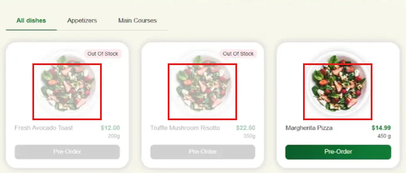
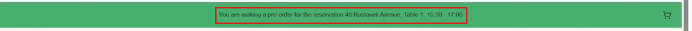
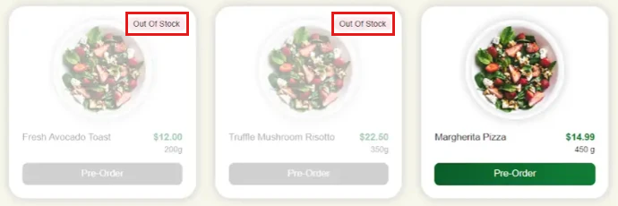
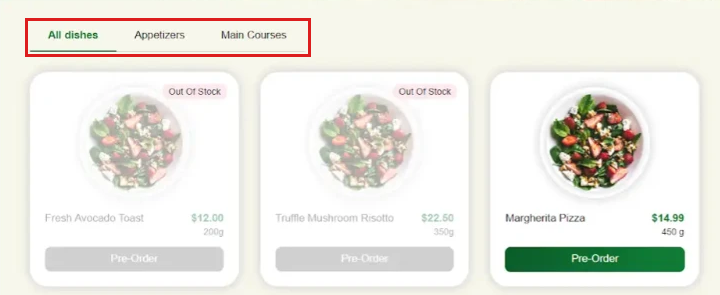
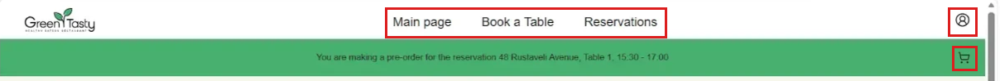
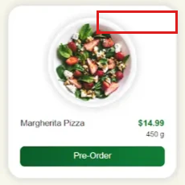
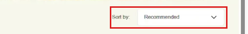
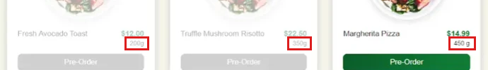

# US11 — Defect reports

**Found on:** the course screenshot of the app (env P_PRD, Microsoft Edge), checked against US11 and Figma, frame "Placing pre-order by guest | Menu". The same reports are in `hw7-us11-qa.xlsx`, sheet "Defect reports".

**Severity:** Blocker > Critical > Major > Minor > Trivial (impact). **Priority:** High > Medium > Low (how soon to fix).

| ID | Summary | Severity | Priority | Test case |
|---|---|---|---|---|
| BUG-01 | Dish images do not match the dishes: "Margherita Pizza" and other dishes show the same salad image | Major | Medium | TC-12 |
| BUG-02 | Reservation strip on the Menu page does not show the reservation date | Minor | Medium | TC-06 |
| BUG-03 | Dish with status "On Stop" is labelled "Out Of Stock" on the guest Menu page | Minor | Medium | TC-21 |
| BUG-04 | Menu opens on an extra "All dishes" tab that mixes dishes of all categories | Minor | Medium | TC-07 |
| BUG-05 | Menu page for a Guest shows the customer header instead of the Guest header | Minor | Medium | TC-05 |
| BUG-06 | Available dish card shows no availability status | Minor | Low | TC-15 |
| BUG-07 | "Sort by" shows "Recommended" by default instead of "Popular First" | Minor | Low | TC-10 |
| BUG-08 | Weight format is inconsistent: "200g", "350g" and "450 g" | Trivial | Low | TC-14 |

## BUG-01: Dish images do not match the dishes: "Margherita Pizza" and other dishes show the same salad image

**Env:** P_PRD (d28jftogiwtein.cloudfront.net, Microsoft Edge)  
**Severity:** Major  
**Priority:** Medium  
**Test case:** TC-12

**Pre-conditions:**

- Reservation status is "Reserved", group pre-order status is "Open".
- Guest has joined the group session via the invite link (US_G10).

**Steps:**

1. Open the invite link.
2. Look at the images of "Fresh Avocado Toast", "Truffle Mushroom Risotto" and "Margherita Pizza".

**Actual result:** All three dishes show the same salad image. "Margherita Pizza" shows a salad.

**Expected result:** Each dish shows its own image that matches the dish (US11 AC2).

**Note:** Check the image URL in the menu API response to see whether the cause is the data or the UI.

**Attachment:**

## BUG-02: Reservation strip on the Menu page does not show the reservation date

**Env:** P_PRD (d28jftogiwtein.cloudfront.net, Microsoft Edge)  
**Severity:** Minor  
**Priority:** Medium  
**Test case:** TC-06

**Pre-conditions:**

- Reservation status is "Reserved", group pre-order status is "Open".
- Guest has joined the group session via the invite link (US_G10).

**Steps:**

1. Open the invite link.
2. Read the green strip under the header.

**Actual result:** "You are making a pre-order for the reservation 48 Rustaveli Avenue, Table 1, 15:30 - 17:00". There is no date.

**Expected result:** The strip shows the address, table, date and time (Figma, frame "Placing pre-order by guest | Menu"), e.g. "… 48 Rustaveli Avenue, Table 1, <date>, 15:30 - 17:00".

**Note:** In the code the strip uses only the address, table and time (frontend guest-pre-order-page.component.html). The date is already available: the "You're Invited!" pop-up shows it, but the strip doesn't use it.

**Attachment:**

## BUG-03: Dish with status "On Stop" is labelled "Out Of Stock" on the guest Menu page

**Env:** P_PRD (d28jftogiwtein.cloudfront.net, Microsoft Edge)  
**Severity:** Minor  
**Priority:** Medium  
**Test case:** TC-21

**Pre-conditions:**

- Reservation status is "Reserved", group pre-order status is "Open".
- Guest has joined the group session via the invite link (US_G10).
- Admin has set a dish status to "On Stop".

**Steps:**

1. Open the invite link.
2. Find the dish with status "On Stop".

**Actual result:** The card has the label "Out Of Stock". The guest menu never shows an "On Stop" label: on the screenshot both unavailable dishes are labelled "Out Of Stock".

**Expected result:** The card shows the dish's current status "On Stop" (US11 AC2, AC4).

**Note:** The screenshot alone does not show which status these two dishes have in the data. The code shows the cause: the guest page replaces the status of every dish that cannot be ordered with "OutOfStock" (frontend guest-pre-order-page.component.ts:130). The backend sends "OnStop" for On Stop dishes. The Figma badge text also differs (see R-30).

**Attachment:**

## BUG-04: Menu opens on an extra "All dishes" tab that mixes dishes of all categories

**Env:** P_PRD (d28jftogiwtein.cloudfront.net, Microsoft Edge)  
**Severity:** Minor  
**Priority:** Medium  
**Test case:** TC-07

**Pre-conditions:**

- Reservation status is "Reserved", group pre-order status is "Open".
- Guest has joined the group session via the invite link (US_G10).

**Steps:**

1. Open the invite link.
2. Look at the category tabs and the dish list.

**Actual result:** Tabs: "All dishes", "Appetizers", "Main Courses". "All dishes" is selected and shows dishes of different categories in one list, without category headings.

**Expected result:** Dishes are structured by category (US11 AC1). Tabs "Appetizers", "Main Courses", "Desserts"; "Appetizers" is selected; no "All dishes" tab (Figma, frame "Placing pre-order by guest | Menu").

**Note:** The "Desserts" tab is also missing. The tabs are built from the menu data, so this location may simply have no desserts. Not reported separately until the data is checked.

**Attachment:**

## BUG-05: Menu page for a Guest shows the customer header instead of the Guest header

**Env:** P_PRD (d28jftogiwtein.cloudfront.net, Microsoft Edge)  
**Severity:** Minor  
**Priority:** Medium  
**Test case:** TC-05

**Pre-conditions:**

- Reservation status is "Reserved", group pre-order status is "Open".
- Guest has joined the group session via the invite link (US_G10).
- The invite link is opened in a browser where a Customer is logged in (as on the screenshot).

**Steps:**

1. Open the invite link.
2. Look at the header and the reservation strip.

**Actual result:** The header shows "Main page", "Book a Table", "Reservations" links and a profile icon. The cart icon is in the green reservation strip, not in the header.

**Expected result:** Guest variant header: logo on the left, cart icon on the right; no navigation links and no profile icon (Figma, frame "Placing pre-order by guest | Menu").

**Note:** In the code, a Guest who is not logged in gets "Main page", "Book a Table" and [Sign In] (frontend header.component.html). That is also not the Guest header.

**Attachment:**

## BUG-06: Available dish card shows no availability status

**Env:** P_PRD (d28jftogiwtein.cloudfront.net, Microsoft Edge)  
**Severity:** Minor  
**Priority:** Low  
**Test case:** TC-15

**Pre-conditions:**

- Reservation status is "Reserved", group pre-order status is "Open".
- Guest has joined the group session via the invite link (US_G10).

**Steps:**

1. Open the invite link.
2. Look at the card of the available dish "Margherita Pizza".

**Actual result:** The card has no status label. Only unavailable dishes have a label.

**Expected result:** Every dish shows its current availability status, including "Available" (US11 AC2).

**Note:** Figma also shows no label on available dishes, so the story and the design disagree (R-31). Confirm with the PO before fixing.

**Attachment:**

## BUG-07: "Sort by" shows "Recommended" by default instead of "Popular First"

**Env:** P_PRD (d28jftogiwtein.cloudfront.net, Microsoft Edge)  
**Severity:** Minor  
**Priority:** Low  
**Test case:** TC-10

**Pre-conditions:**

- Reservation status is "Reserved", group pre-order status is "Open".
- Guest has joined the group session via the invite link (US_G10).

**Steps:**

1. Open the invite link.
2. Look at the "Sort by" dropdown.

**Actual result:** "Recommended" is selected.

**Expected result:** "Popular First" is selected. Options: "Popular First", "Newest First", "Price Low to High", "Price High to Low" (Figma, frame "Placing pre-order by guest | Menu").

**Note:** The screenshot does not show the open list. In the code the options are "Recommended", "Price: Low to high" and "Price: High to low" (frontend guest-pre-order-page.component.html), so "Popular First" and "Newest First" are missing too.

**Attachment:**

## BUG-08: Weight format is inconsistent: "200g", "350g" and "450 g"

**Env:** P_PRD (d28jftogiwtein.cloudfront.net, Microsoft Edge)  
**Severity:** Trivial  
**Priority:** Low  
**Test case:** TC-14

**Pre-conditions:**

- Reservation status is "Reserved", group pre-order status is "Open".
- Guest has joined the group session via the invite link (US_G10).

**Steps:**

1. Open the invite link.
2. Compare the weight on all dish cards.

**Actual result:** "200g" and "350g" have no space; "450 g" has a space.

**Expected result:** One format for all dishes: a number, a space and "g", e.g. "450 g" (Figma, frame "Placing pre-order by guest | Menu").

**Note:** The card shows the weight text exactly as stored (frontend dish-card.component.html:20), so the fix is either in the data or in formatting.

**Attachment:**

